# Let Coffee — identidad de marca

Identidad completa para **Let Coffee**, café de Resistencia, Chaco. *"Café para gente apurada y para gente que no."*

**🌐 Sitio web de la marca: [let-coffee.rushdesign.workers.dev](https://let-coffee.rushdesign.workers.dev/)**
**💻 Proyecto web: [let-coffee-showcase](https://github.com/rush71/let-coffee-showcase)**

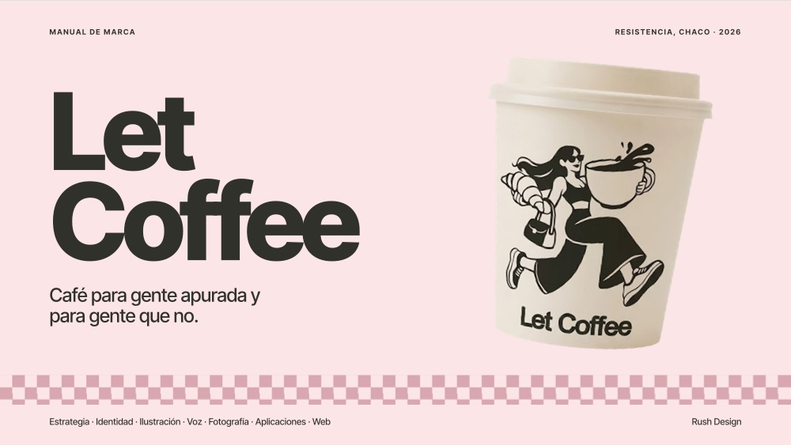

## Documentos (PDF)
| Documento | Qué es |
|---|---|
| 📄 [**Manual de marca**](pdf/let-coffee-manual-de-marca.pdf) | Presentación de 18 diapositivas: fundamentos, logo, color, tipografía, ilustración, voz, fotografía, aplicaciones y web |
| 📄 [**Caso de estudio**](pdf/let-coffee-caso.pdf) | Versión vertical, estilo Behance: la idea, el logo, la tipografía, el color, los íconos, la carta y las aplicaciones |

## Qué se diseñó
- **Estrategia:** dos velocidades, un mismo café. Valores y posicionamiento.
- **Logo:** un sistema de cuatro piezas, con prueba de tamaño mínimo.
- **Color y tipografía:** paleta medida desde las piezas originales; Inter Tight.
- **Ilustración:** personaje dibujado a mano y vectorizado, con poses, íconos y patrones.
- **Voz y fotografía:** cómo habla y cómo se ve la marca.
- **Aplicaciones:** vasos, bolsas, cartel de fachada, carta y piezas digitales.
- **Web:** la marca llevada a pantalla.

## Vista previa del manual
<table>
  <tr>
    <td>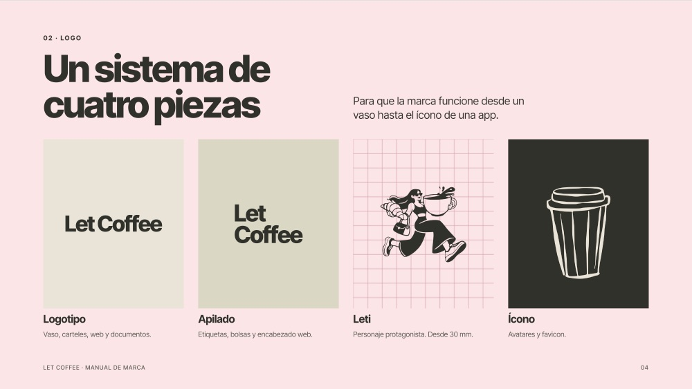</td>
    <td>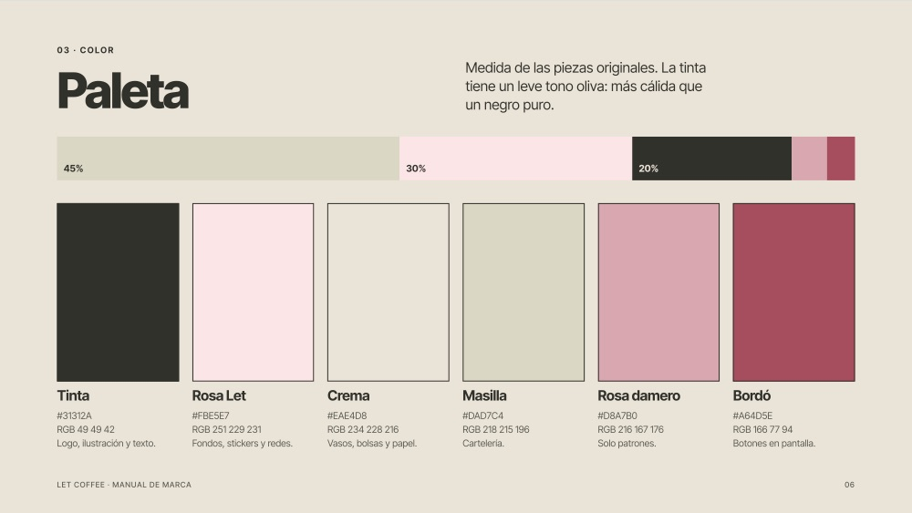</td>
  </tr>
  <tr>
    <td>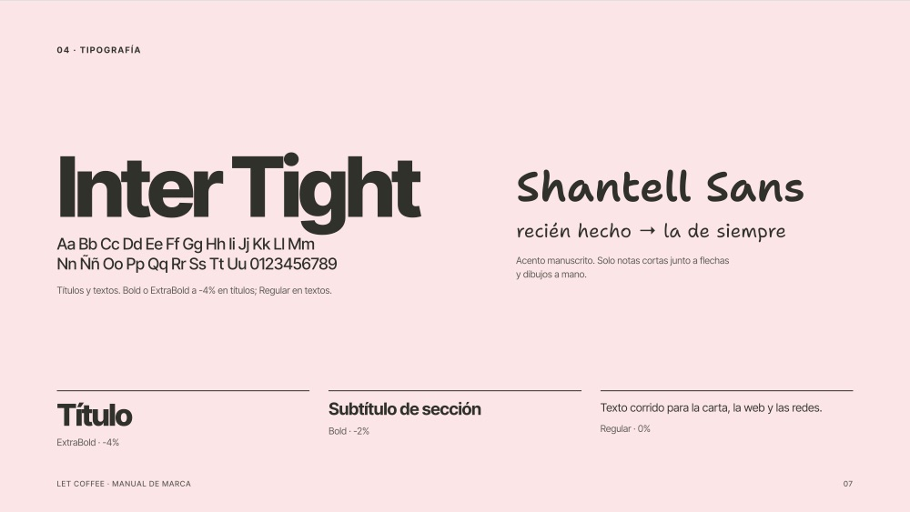</td>
    <td>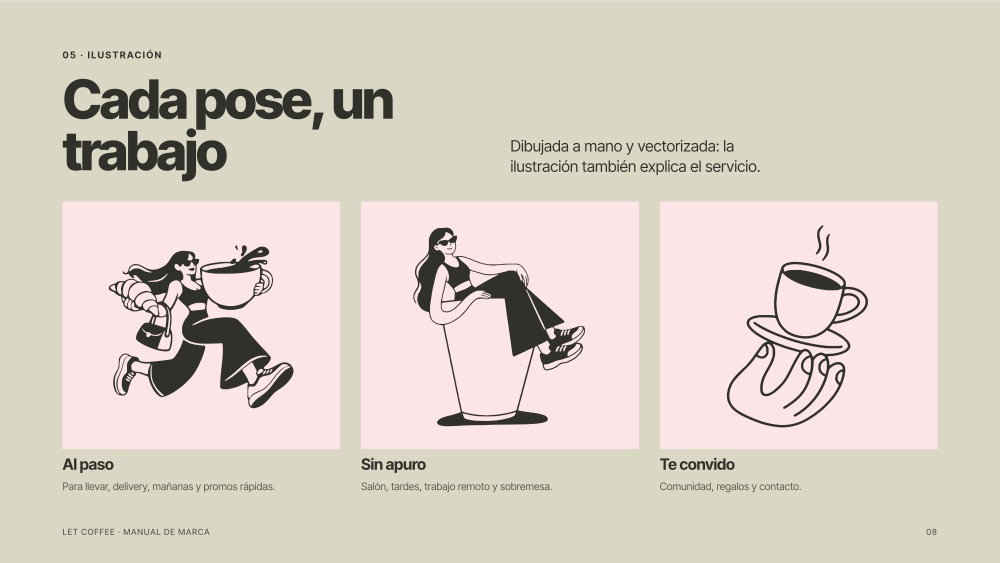</td>
  </tr>
  <tr>
    <td>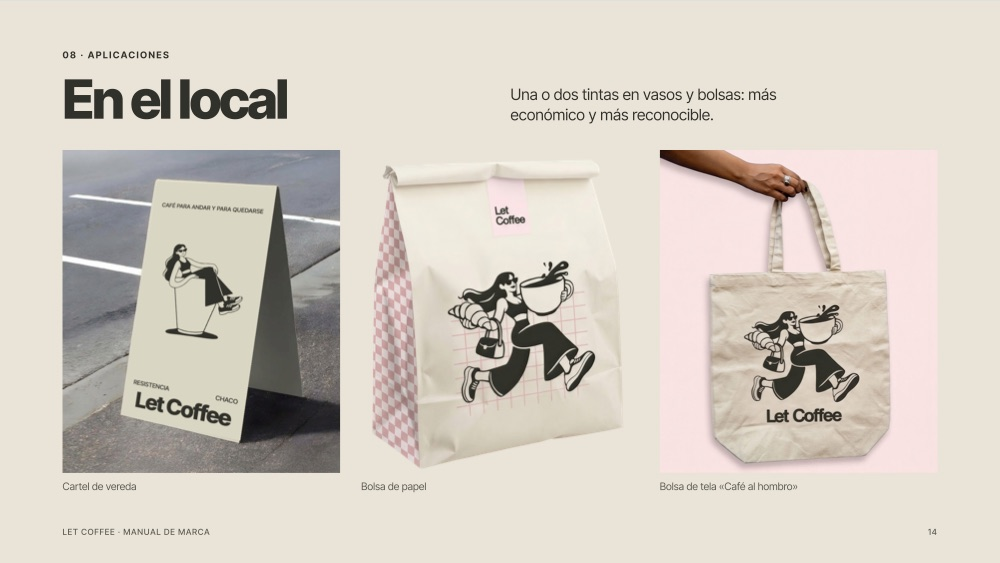</td>
    <td>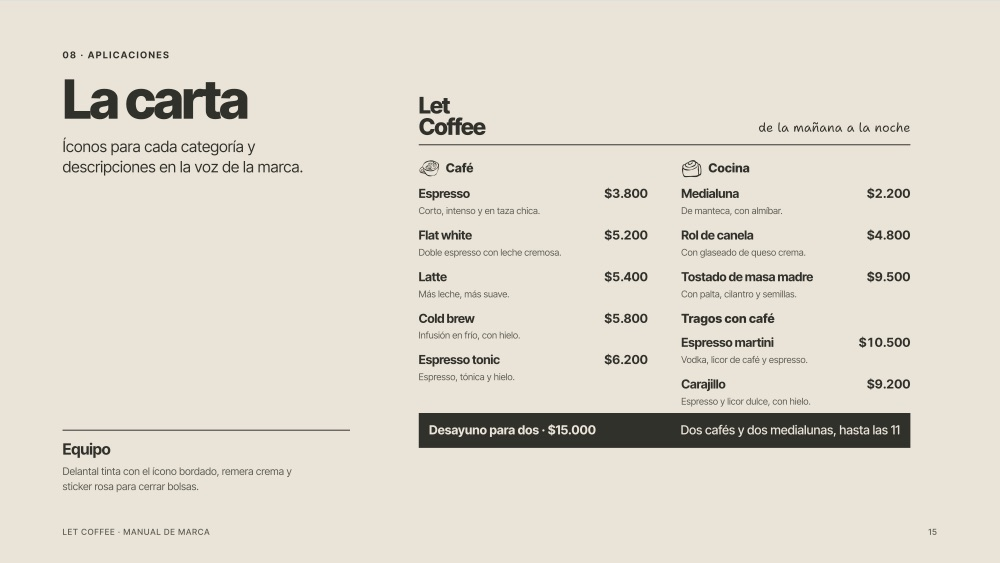</td>
  </tr>
</table>

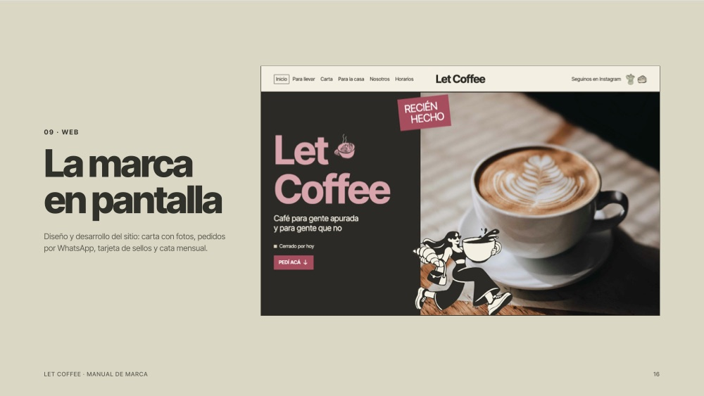

## Vista previa del caso de estudio
<table>
  <tr>
    <td>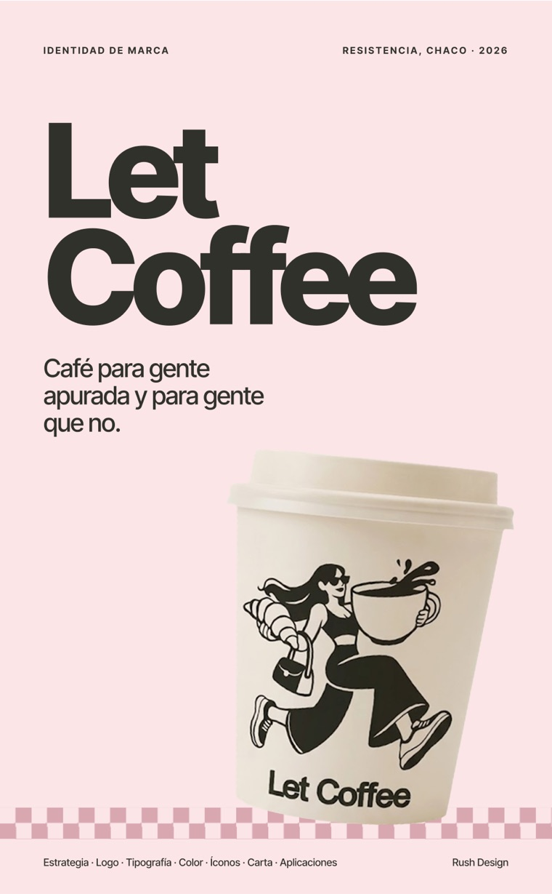</td>
    <td>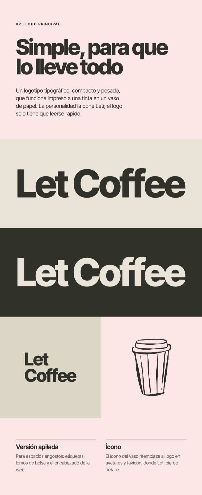</td>
    <td>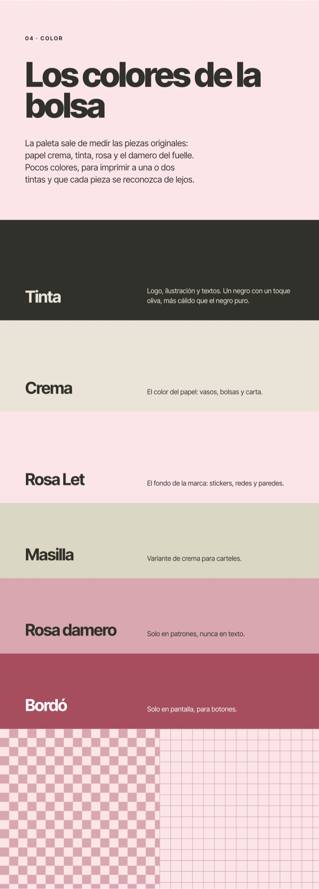</td>
    <td>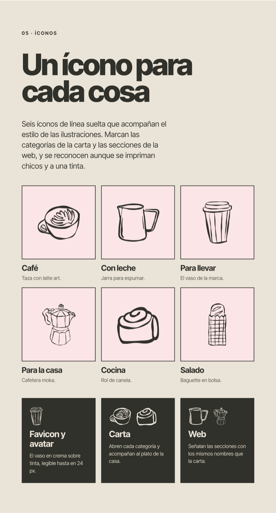</td>
  </tr>
</table>

© 2026 Francisco Montilla — Rush Design. Todos los derechos reservados sobre la marca, el logo, el personaje y los íconos.
